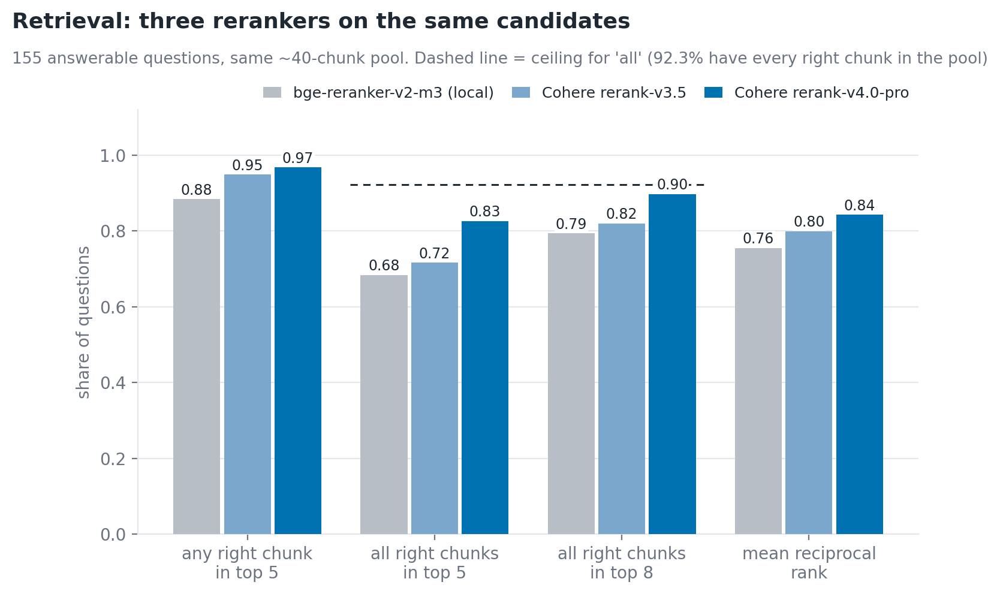
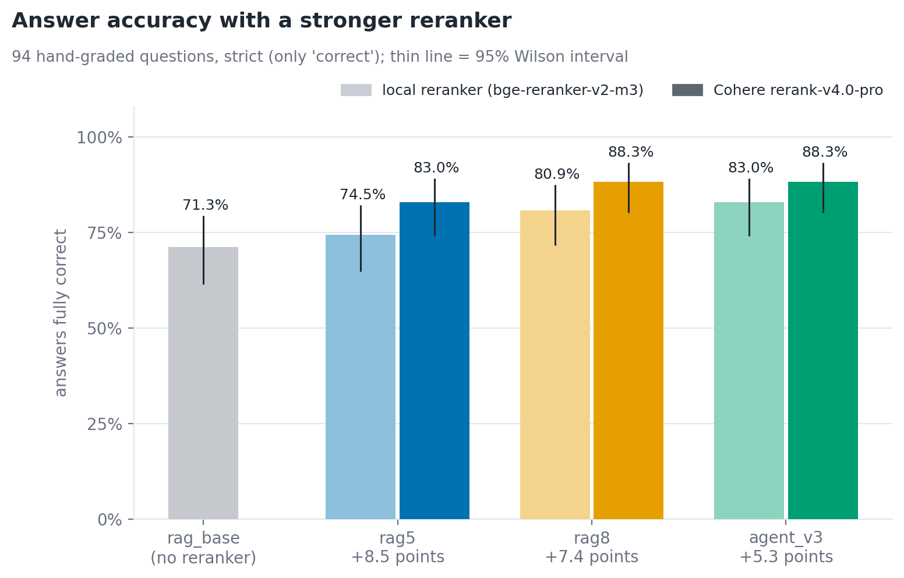
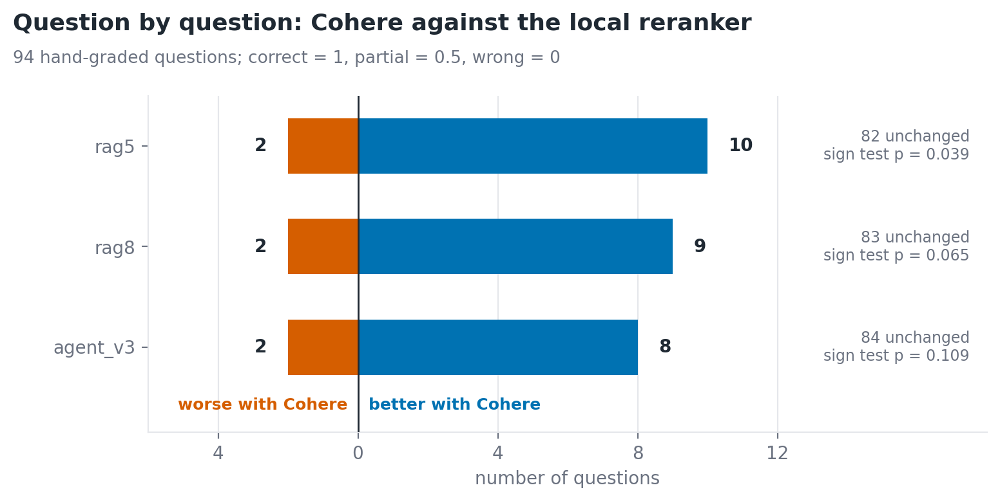
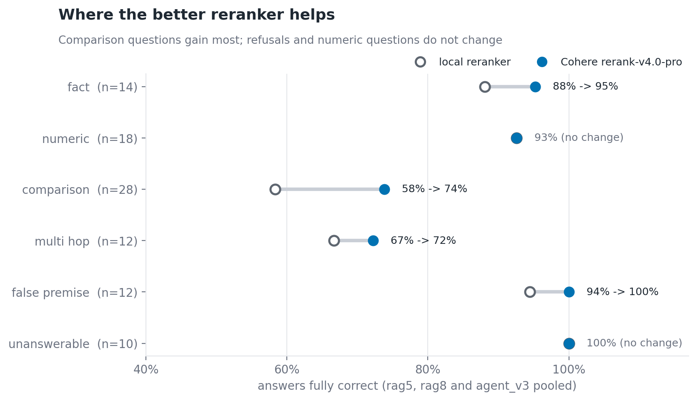

# Agentic RAG with evaluation over SEC 10-K filings: report

This report describes what was built, why each choice was made, how the systems were evaluated, and what the results do
and do not show. Every number in it comes from files in this repository (`results/`, `questions/`) and can be
recomputed with `python -m src.eval.grades_report`. Choices that were measured are labelled as such; choices that were
only reasoned (not tested against alternatives) are labelled as such too.

## 1. Summary

* **Task.** Answer questions about the annual reports (10-K) of 19 US companies, cite the passages used, and refuse
  when the filings do not contain the answer.
* **Systems compared** (same language model, same prompt): `rag_base` (dense search, 5 passages), `rag5` (company/year
  filter + reranker, 5 passages), `rag8` (filter + keyword/dense hybrid + reranker, 8 passages) and `agent_v3` (a
  LangGraph agent that plans one search per company and year, checks what is missing and searches again).
* **Evaluation.** 175 questions with hand-written answers and evidence passages; 94 of them (test and agentic sets)
  graded by hand, blind, against the reference answer.
* **Main result.** Fully correct answers on the 94 graded questions: 71.3% (`rag_base`), 74.5% (`rag5`), 80.9%
  (`rag8`), 83.0% (`agent_v3`). Giving 8 passages with hybrid search instead of 5 helped clearly (`rag8` better than
  `rag5` on 10 questions, worse on 1). The agent was better than `rag8` on the questions that involve several
  companies (83.3% against 66.7% on 30 questions) at about 2.5 times the time, but with so few questions the
  difference is not statistically clear.
* **A stronger reranker helps.** Replacing the local reranker with Cohere `rerank-v4.0-pro` raised the share of
  questions with all the right chunks in the top 5 from 68% to 83% (155 questions) and the fully correct answers to
  83.0% (`rag5`), 88.3% (`rag8`) and 88.3% (`agent_v3`) on the 94 graded questions. With it, the agent is no longer
  ahead of `rag8` (section 8).
* **What did not help.** Writing tables value by value (row and column) did not improve retrieval or answers over
  plain text (section 7).
* **Main limits.** One grader, small question sets (wide intervals), one language model, one embedding model, one chunk
  size, a 38-filing corpus, and test questions that were read during development (section 10).

## 2. Data

**Source.** SEC EDGAR, the public archive of company filings. The client follows the SEC rules: a User-Agent with a
name and email address (read from an ignored `.env` file, never committed), at most 5 requests per second, and retries
with a wait on errors 429/5xx.

**Companies.** 19 companies, two fiscal years each, 38 filings:

* banks and financials: JPM, BAC, GS, COF, SCHW, TFC
* insurers: MET, AIG, PRU, TRV
* technology: MSFT, GOOGL, AMZN, NVDA, META, AAPL
* others: PFE, JNJ, WMT

Financial companies make up about half of the list; their filings are number-heavy and table-heavy.

**Sections.** Only Item 1 (business), Item 1A (risk factors) and Item 7 (management's discussion and analysis, MD&A)
are kept. Sections are found from the "Item X" headings. Some filers put only a cross-reference under Item 7 and place
the real MD&A in a separate financial section; a fallback looks for the title "Management's Discussion and Analysis"
and stops at the first end marker. The extraction returns warnings instead of failing silently, and repeated page
footers (company name, year, page number) are removed.

**Chunks.** Maximum 1,600 characters (about 400 tokens), 200 characters of overlap, paragraphs are not split, and a
final piece shorter than 300 characters is merged into the previous chunk. Result: 9,592 chunks (business 1,955, risk
factors 3,021, MD&A 4,616). Each chunk has a clean `text` (shown and cited) and an `embed_text` (with company, period
and section in a header, used only to compute the embedding). *The chunk size was not compared with other sizes.*

## 3. Retrieval

* **Embeddings:** `BAAI/bge-m3` (dense, 1,024 dimensions), fp16, maximum length 640 tokens. The longest chunk measured
  633 tokens, so nothing is cut. Vectors are normalised and stored as float16.
* **Index:** exact FAISS `IndexFlatIP`. With about 10,000 vectors an exact search takes milliseconds; an approximate
  index would only add parameters. *Reasoned, not benchmarked.*
* **Scope detection** (`src/retrieval/scope.py`): rules, not a model, find which company and year a question is
  about. If the question does not name a company ("the maker of the iPhone"), no filter is applied: no filter is
  better than a wrong one.
* **Keyword search:** a BM25 written for this project (k1 = 1.5, b = 0.75, with tests). It is used in the hybrid
  setting.
* **Reranker:** cross-encoder `BAAI/bge-reranker-v2-m3` (fp16, length 640). It reads the question and a passage
  together, which is slower but more precise, so it is used only on a candidate pool.

**Ablation on the development questions (71 questions with an answer, no language model).** This analysis was run
during development with the same chunks and is not re-run in this repository; the numbers are kept in the first
version's output.

| setting | hit@5 | all@5 | all@10 | MRR |
|---|---|---|---|---|
| dense (baseline) | 0.732 | 0.549 | 0.676 | 0.533 |
| dense + company/year filter | 0.761 | 0.592 | 0.704 | 0.586 |
| dense + reranker | 0.831 | 0.634 | 0.789 | 0.696 |
| filter + reranker | 0.887 | 0.718 | 0.831 | 0.757 |

`hit@k`: at least one evidence chunk among the top k. `all@k`: all evidence chunks among the top k. The reranker and
the filter each help, and together most. `all@5` stays well below `hit@5`, which is why `rag8` and the agent give
8 passages to the model instead of 5: the evidence of a question often needs several chunks and the fifth place is
too tight. Whether 8 is better is tested on hand-graded answers (section 6), not on this table.

## 4. Generation and the agent

**Language model.** `Qwen/Qwen3.5-9B`, 4-bit NF4 with fp16 compute (the free Colab T4 has no bf16), greedy decoding,
"thinking" off. It uses about 9.6 GB and fits the free T4. A smoke test on 7 questions (not a benchmark) gave 100%
right behaviour for Qwen3.5-9B and 86% for Qwen3-8B at similar speed. *No stronger model was compared.*

**Answer prompt.** Use only the given passages, cite the passage ids in square brackets after each claim, and write
exactly `NOT_FOUND` when the information is not there. Refusals are detected by code, not by reading.

**Agent (`agent_v3`)**: a LangGraph graph with four steps, *plan -> search -> check -> answer*.

1. **Plan.** The model returns a JSON list of searches, one for every company and year that is needed, each with a
   descriptive query. If a question describes a company without naming it, the model picks the ticker from the list.
   If the JSON is invalid, the agent falls back to a plain search with the rule-based scope.
2. **Search.** Each search is restricted to one company and year and takes 4 candidates (6 when there is a single
   search).
3. **Check.** For every company and year needed, the model writes the id of the passage that contains the number, or
   `MISSING`, and then a JSON line saying whether the evidence is enough and, if not, which searches to add (at most
   3). At most 2 rounds of search.
4. **Answer.** The context has 8 passages: the 2 best of every planned search, then filled by ranking the rest with
   the original question.

**How the agent got its design.** An earlier version already planned, searched and checked, but did not improve the
questions with several companies. Reading its traces showed that the plan was right (one search per company and
year) while the passages with the numbers did not reach the model, because everything was ranked with the original
question and a generic passage could beat the one with the number. The fix was to select passages per search and to
add the checklist. The questions of the agentic set guided this diagnosis (see the limitations).

A faster variant (`agent_v3_fast`) skips the check when the plan has a single search. It applies to 89 of the 175
questions and cut the mean time on them from 32.7 to 20.0 seconds. It is not the main configuration.

## 5. Question set and evaluation protocol

**Questions.** 175 questions (`questions/questions.jsonl`), each with a hand-written reference answer and the evidence
chunks. 155 have an answer in the filings and 20 are *unanswerable* (the correct behaviour is to refuse; the absence
was checked with keyword search).

| set | ids | n | fact | numeric | comparison | multi_hop | false_premise | unanswerable |
|---|---|---|---|---|---|---|---|---|
| dev | Q001-Q081 | 81 | 25 | 18 | 13 | 10 | 5 | 10 |
| test | Q082-Q145 | 64 | 10 | 14 | 16 | 8 | 10 | 6 |
| agentic | Q146-Q175 | 30 | 4 | 4 | 12 | 4 | 2 | 4 |

* `fact`: one piece of information. `numeric`: one number. `comparison`: companies or years against each other.
  `multi_hop`: needs several passages. `false_premise`: the question starts from something wrong and the system must
  correct it. `unanswerable`: not in the corpus, the system must refuse.
* The `agentic` set was written for questions about several companies or without a named company (multi-company,
  descriptions, computed values, dependent questions, reverse lookup).
* A validator (`python -m src.eval.golden`) checks the format, unique ids, that every evidence chunk exists and
  belongs to the indicated filing, and that dates and tickers are consistent.

**Automatic checks** (all 175 questions): right behaviour (answers when it should, refuses when it should), valid
citations, whether a citation points to an evidence chunk, retrieval metrics, and whether the key numbers of the
reference answer appear in the answer (an indicator only). There is no language-model judge.

**Hand grading** (94 questions: test and agentic). Each answer is graded `correct`, `partial` or `wrong` against the
reference answer, on sheets where rows are shuffled and the grader does not know which system or chunking produced the
answer. Identical answers share a row and so share the grade. The development set (81 questions) was *not* graded by
hand. There is one grader.

**Statistics.** Wilson 95% intervals for proportions. For comparisons, the paired difference on the same question
(correct 1, partial 0.5, wrong 0) and an exact two-sided sign test. No correction for multiple comparisons.

## 6. Results

All numbers below come from `python -m src.eval.grades_report`. "Strict" counts only `correct`; "lenient" also counts
`partial`. This section uses the local reranker (bge-reranker-v2-m3) in every system that has one; section 8 repeats
the evaluation with a stronger, hosted reranker and compares the two.

**All 94 graded questions (text chunks)**

| system | correct | partial | wrong | strict (95% CI) | lenient |
|---|---|---|---|---|---|
| `rag_base` | 67 | 5 | 22 | 71.3% (61-79) | 76.6% |
| `rag5` | 70 | 9 | 15 | 74.5% (65-82) | 84.0% |
| `rag8` | 76 | 8 | 10 | 80.9% (72-88) | 89.4% |
| `agent_v3` | 78 | 7 | 9 | 83.0% (74-89) | 90.4% |

**Test set (64 questions)**

| system | strict (95% CI) | lenient |
|---|---|---|
| `rag_base` | 78.1% (67-86) | 85.9% |
| `rag5` | 79.7% (68-88) | 92.2% |
| `rag8` | 87.5% (77-94) | 95.3% |
| `agent_v3` | 82.8% (72-90) | 93.8% |

**Agentic set (30 questions)**

| system | strict (95% CI) | lenient |
|---|---|---|
| `rag_base` | 56.7% (39-73) | 56.7% |
| `rag5` | 63.3% (46-78) | 66.7% |
| `rag8` | 66.7% (49-81) | 76.7% |
| `agent_v3` | 83.3% (66-93) | 83.3% |

**Fully correct answers by question type (94 questions)**

| type | n | `rag_base` | `rag5` | `rag8` | `agent_v3` |
|---|---|---|---|---|---|
| fact | 14 | 13 | 12 | 13 | 12 |
| numeric | 18 | 17 | 16 | 17 | 17 |
| comparison | 28 | 12 | 13 | 17 | 19 |
| multi_hop | 12 | 6 | 8 | 8 | 8 |
| false_premise | 12 | 9 | 11 | 11 | 12 |
| unanswerable | 10 | 10 | 10 | 10 | 10 |

**Paired comparisons (94 questions; mean score difference, questions better/worse, sign test p)**

| comparison | difference | better / worse | p |
|---|---|---|---|
| `rag5` - `rag_base` | +0.053 | 12 / 7 | 0.36 |
| `rag8` - `rag5` | +0.059 | 10 / 1 | 0.012 |
| `rag8` - `rag_base` | +0.112 | 15 / 3 | 0.008 |
| `agent_v3` - `rag8` | +0.016 | 7 / 4 | 0.55 |
| `agent_v3` - `rag5` | +0.074 | 13 / 4 | 0.049 |
| `agent_v3` - `rag_base` | +0.128 | 17 / 4 | 0.007 |
| agentic set only: `agent_v3` - `rag8` | +0.117 | 6 / 1 | 0.125 |
| agentic set only: `agent_v3` - `rag_base` | +0.267 | 9 / 1 | 0.021 |

**Reading the results**

1. **More passages and hybrid search help.** `rag8` is clearly better than `rag5` and `rag_base`. The filter and
   reranker alone (`rag5` against `rag_base`) are not clearly better on these questions (p = 0.36), even though they
   are much better on the retrieval metrics of section 3. A better ranking does not always change the answer.
2. **The agent is not clearly better than `rag8` overall** (+0.016, p = 0.55). Its advantage is concentrated in
   comparison questions (19 correct against 17) and in the agentic set (83.3% against 66.7%). With 30 questions that
   difference is not statistically clear (p = 0.125 and the intervals overlap).
3. **Time.** Mean seconds per question on a T4, over the 175 questions: `rag_base` 12.6, `rag5` 14.4, `rag8` 15.9,
   `agent_v3` 39.0 (about 2.5 times `rag8`).
4. **Refusals and false premises** are mostly handled by every system: all four refuse correctly on the 10 graded
   unanswerable questions.
5. **Automatic checks (175 questions)**, text chunks:

| system | right behaviour | citation points to evidence | key numbers in answer |
|---|---|---|---|
| `rag_base` | 85.1% | 60.0% | 40.0% |
| `rag5` | 92.0% | 73.5% | 45.8% |
| `rag8` | 92.6% | 77.4% | 47.7% |
| `agent_v3` | 94.3% | 78.1% | 50.3% |

These are indicators, not correctness: the last column in particular counts only the numbers written in the answer.

**Reproducibility.** Running the text variant again in this repository gave exactly the same answers as the first
run for every question and system (greedy decoding, same model and chunks).

## 7. Table-aware chunking: a negative result

SEC filings are full of tables, and flattening them loses the meaning of the columns ("Revenue 391 383"). The
alternative tested here writes every value together with its row and column and makes each table its own chunk,
for example `iPhone: 2026 = $254,098; 2025 = $209,586`. The parser also takes the table title from the table itself,
gives a table split in two the header of the first part, matches rows with fewer values to the year columns, removes
money units from percentage tables, and keeps a short table in the same chunk as the paragraph before it
(`src/ingest/tables.py`).

**Retrieval** (155 answerable questions, no language model). The evidence of the table version is translated from the
text chunks by matching content, so `hit@5` and `recall@5` are approximate. The last column does not depend on that
translation: the share of questions where every number of the reference answer (3 or more digits, not years) appears in
the 5 best passages.

| setting | chunks | hit@5 | recall@5 | numbers in top 5 |
|---|---|---|---|---|
| dense only | text | 0.716 | 0.614 | 0.521 |
| dense only | tables | 0.742 | 0.526 | 0.427 |
| filter + reranker | text | 0.852 | 0.773 | 0.594 |
| filter + reranker | tables | 0.890 | 0.686 | 0.562 |
| filter + hybrid + reranker | text | 0.884 | 0.788 | 0.594 |
| filter + hybrid + reranker | tables | 0.884 | 0.681 | 0.562 |

`hit@5` is equal or slightly higher with tables, but `recall@5` and the number-based measure are lower. In the paired
view the differences on `hit@5` are not significant in any setting.

**Answers** (94 hand-graded questions, text against table-aware chunks):

| system | strict, text | strict, tables | tables minus text (score) | better / worse | p |
|---|---|---|---|---|---|
| `rag_base` | 71.3% | 59.6% | -0.096 | 5 / 15 | 0.041 |
| `rag5` | 74.5% | 73.4% | -0.016 | 7 / 9 | 0.80 |
| `rag8` | 80.9% | 81.9% | -0.005 | 5 / 3 | 0.73 |
| `agent_v3` | 83.0% | 85.1% | +0.021 | 6 / 2 | 0.29 |

For the three stronger systems the difference is within the noise; only the simplest system is clearly worse (and
that is one test among four, uncorrected). By question type, with the four systems pooled, mean scores moved from 0.938
to 0.882 on numeric questions and from 0.771 to 0.698 on multi-hop questions, and were nearly equal on the others.
An earlier version of the table parser (git tag `eval-tables-v1`) was graded as well and gave a similar picture (strict
accuracy 59.6%, 70.2%, 80.9%, 81.9% for the four systems). The final pipeline therefore uses plain-text chunks, and
the table parser is kept as an option (`02b_chunk_and_embed_tables.ipynb`).

The tables did improve a few individual answers (mostly comparison questions). In several of them the model received no
table chunk, so these changes look like effects of a different retrieval rather than of the table format; no cause was
established.

## 8. A stronger reranker (Cohere Rerank 4)

**Why this was tried.** In the retrieval analysis of the first version of the project, the right chunks were
inside the candidate pool for about 96% of the questions, but all of them reached the top 5 for only about 70%
(section 3; that analysis was not repeated). The final pool is similar: all the right chunks are among the
candidates for 92.3% of the answerable questions, while the local reranker puts all of them in the top 5 for only
68.4%. Most of the room for improvement was therefore in the ordering of the candidates, not in finding them. The
local reranker (bge-reranker-v2-m3) was compared with two hosted rerankers, Cohere `rerank-v3.5` and
`rerank-v4.0-pro`, through the Cohere API (free trial key). All existing systems and results were kept; they are the
benchmark that the new results are compared with.

### 8.1 Retrieval only (notebook 05)

This step does not generate any answer, so it is cheap. For each of the 155 answerable questions the candidate pool of
`rag8` (company/year filter, dense and BM25 candidates, about 40 chunks) is built once, and each reranker orders the
same pool. Any difference therefore comes from the reranker alone. As a check, the local reranker gives exactly the
`rag8` numbers of section 3 (hit@5 0.884, recall@5 0.788).

| reranker | hit@5 | all@5 | all@8 | recall@5 | MRR | R-precision |
|---|---|---|---|---|---|---|
| bge-reranker-v2-m3 (local) | 0.884 | 0.684 | 0.794 | 0.788 | 0.755 | 0.580 |
| Cohere `rerank-v3.5` | 0.948 | 0.716 | 0.819 | 0.831 | 0.799 | 0.620 |
| Cohere `rerank-v4.0-pro` | **0.968** | **0.826** | **0.897** | **0.905** | **0.843** | **0.695** |

R-precision looks at the first R results, where R is the number of right chunks of the question, and counts the
share that are right (a question with two right chunks scores 0.5 if only one is in the first two places). It is
not shown in the figure.

* `rerank-v4.0-pro` put all the right chunks in the top 5 for more questions than the local reranker on 24 questions
  and for fewer on 2 (sign test p < 0.001); in the top 8 on 17 questions against 1 (p < 0.001).
* By R-precision `rerank-v4.0-pro` is better than the local reranker on 35 questions and worse on 11 (p < 0.001).
  On the 66 questions with more than one right chunk it goes from 0.50 to 0.60; for the 89 questions with a single
  right chunk R-precision is the same as hit@1.
* `rerank-v3.5` is not clearly different from the local reranker (all@5: 15 better, 10 worse, p = 0.42).
* The gain holds in all three question sets (all@5, local to `rerank-v4.0-pro`): development 0.70 to 0.85 (71
  questions), test 0.76 to 0.86 (58), agentic 0.46 to 0.69 (26).
* With `rerank-v4.0-pro` the top 8 contain all the right chunks for 89.7% of the questions, close to the ceiling of
  92.3% set by the candidate pool. Most of what is left would have to come from better candidates.

Only `rerank-v4.0-pro` was carried to the next step. It was chosen because it was the better of the two on this
retrieval test, which uses the same questions as the graded set, so a small selection effect is possible.

### 8.2 The systems with the better reranker (notebook 06)

`rag5`, `rag8` and `agent_v3` were run again on all 175 questions, with the same language model, prompts, chunks and
decoding as in section 6. The only change is the reranker (`rerank-v4.0-pro`, used everywhere the local reranker was
used, including the agent's final selection of passages). `rag_base` has no reranker, so it was not run again and its
answers stay as they were. The answers were graded by hand with the same protocol as in section 5: blind and
shuffled, against the reference answer. Of the 282 new answers on the 94 graded questions, 115 were identical to an
answer already graded for the same question (in any earlier run) and kept that grade (no case had two different
grades); the other 167 were graded again.

**All 94 graded questions**

| system | reranker | correct | partial | wrong | strict (95% CI) | lenient |
|---|---|---|---|---|---|---|
| `rag_base` | none | 67 | 5 | 22 | 71.3% (61-79) | 76.6% |
| `rag5` | local | 70 | 9 | 15 | 74.5% (65-82) | 84.0% |
| `rag5` | Cohere | 78 | 7 | 9 | 83.0% (74-89) | 90.4% |
| `rag8` | local | 76 | 8 | 10 | 80.9% (72-88) | 89.4% |
| `rag8` | Cohere | 83 | 6 | 5 | 88.3% (80-93) | 94.7% |
| `agent_v3` | local | 78 | 7 | 9 | 83.0% (74-89) | 90.4% |
| `agent_v3` | Cohere | 83 | 6 | 5 | 88.3% (80-93) | 94.7% |

**Question by question (Cohere against local, same system; mean score difference, better/worse, sign test p)**

| system | all 94 | test (64) | agentic (30) |
|---|---|---|---|
| `rag5` | +0.074, 10/2, p = 0.039 | +0.031, 4/2, p = 0.69 | +0.167, 6/0, p = 0.031 |
| `rag8` | +0.064, 9/2, p = 0.065 | +0.031, 4/2, p = 0.69 | +0.133, 5/0, p = 0.062 |
| `agent_v3` | +0.048, 8/2, p = 0.109 | +0.047, 5/1, p = 0.22 | +0.050, 3/1, p = 0.63 |

**Fully correct answers by question type (local to Cohere)**

| type | n | `rag5` | `rag8` | `agent_v3` |
|---|---|---|---|---|
| fact | 14 | 12 to 14 | 13 to 13 | 12 to 13 |
| numeric | 18 | 16 to 16 | 17 to 17 | 17 to 17 |
| comparison | 28 | 13 to 18 | 17 to 22 | 19 to 22 |
| multi_hop | 12 | 8 to 8 | 8 to 9 | 8 to 9 |
| false_premise | 12 | 11 to 12 | 11 to 12 | 12 to 12 |
| unanswerable | 10 | 10 to 10 | 10 to 10 | 10 to 10 |

**Reading the results**

1. **A better ranking gives better answers, but less than it gives in retrieval.** All three systems improve
   (+5 to +8 points of fully correct answers), and no comparison goes the wrong way: each system is better on 8-10
   questions and worse on 2. Only `rag5` reaches p < 0.05; for `rag8` and the agent the direction is the same but the
   94 questions do not show it clearly. In retrieval the same change was +14 points on all@5.
2. **The gain is concentrated in comparison questions** (13, 17 and 19 correct become 18, 22 and 22 of 28), which
   need several passages, and in the agentic set. Numeric questions, refusals and multi-hop questions hardly change.
3. **The reranker and the agent now do about the same job.** With the local reranker the agent was 2 points ahead of
   `rag8` (83.0% against 80.9%) and clearly ahead in the agentic set (83.3% against 66.7%). With the better reranker
   both reach 88.3%, with 5 questions better on each side (p = 1.0), and in the agentic set the two are 86.7% and
   83.3%. A good part of what the agent's extra searches were buying was a better choice among the passages.
   This is a statement about these 94 questions only: the earlier advantage was also not statistically clear.
4. **Does the right chunk reach the model?** On the 94 graded questions, the share of answerable questions whose
   right chunks are all among the passages given to the model went from 0.655 to 0.738 (`rag5`), from 0.750 to 0.881
   (`rag8`) and from 0.821 to 0.845 (`agent_v3`). This agrees with the answer-level results.
5. **Cost.** `rag8` needs one reranker call per question and `rag5` one; the agent needs about five (one per search
   and one for the final choice of passages). Running all 175 questions took about 1,100 calls in total, more than a
   free trial key allows in a month, so the run was split over several sessions. Every ranking is cached by content
   (question, passages and model), so repeating the analysis does not call the API again. Times per question are not
   comparable with section 6, because the trial key allows only about 10 calls a minute and the runs wait for it.

### 8.3 What this does and does not show

* It shows that, for this corpus and this language model, the reranker was a bottleneck, and that a stronger
  reranker removes a measurable part of the errors without changing the generator.
* It does not show that Cohere's reranker is the best one: only two Cohere models were compared with one local
  model. A larger local reranker or a different local model were not tried, so it is not known how much of the gain
  could be obtained without an external service.
* The answer-level gains are moderate against the width of the intervals: the 95% intervals of the old and new
  accuracy overlap for every system. The paired comparison is the more informative one, and it is uncorrected for the
  many comparisons made in this report.
* The new answers were graded after the earlier grades had been given; the sheet was blind and shuffled, but it is
  the same grader. Reused grades apply only to answers whose text is identical.
* The reranker is a hosted model on a trial key, which is limited and cannot be used commercially. The model behind
  the name can change over time, so a later run may not reproduce these rankings exactly; the cached rankings are kept
  with the raw answers in the private dataset for this reason.

## 9. Where the errors are

An early error analysis (an earlier version of the systems, test questions, 13 of 64 answers not fully correct)
found that most failures were retrieval misses, with the evidence chunk not in the top 5, and that the missed chunks
were mostly numeric tables with little prose around them. Arithmetic was the cause in about one case, so a calculator
tool was judged to be of little value. In the final evaluation the weak points are the same two groups:
comparison questions (12 to 19 correct out of 28) and multi-hop questions (6 to 8 out of 12), which need evidence from
several places. That analysis was not repeated on the final systems. With the stronger reranker of section 8 the comparison
questions improve most (13, 17 and 19 correct become 18, 22 and 22 of 28), which fits the idea that these questions
need several right passages in the context; comparison and multi-hop questions (8 or 9 of 12) remain the weakest
groups.

The agent's check asked for a second round of search in 121 of the 175 questions; it is *not verified* whether those
extra searches were needed.

## 10. Limitations

* **Test questions were read during development.** The test questions were inspected in the error analysis, and the
  agentic set guided the design of the agent. Their results are therefore not a fully blind test.
* **The development set (81 questions) has no hand grades.** Its results are available only from the automatic
  checks.
* **One grader.** Grades were given by one person, blind to the system but not independent. There is no estimate of
  grader agreement.
* **Small sets, wide intervals.** The agentic set has 30 questions; many differences between neighbouring systems are
  within the noise. Several comparisons are reported without correction for multiple tests.
* **One of everything.** One language model (Qwen3.5-9B, 4-bit), one embedding model, one chunk size (1,600
  characters), and two families of rerankers (one local, one hosted). Other choices could change the ranking of the
  systems. No stronger or hosted *language* model was tried.
* **The better reranker is a hosted service.** It was used with a free trial key (rate-limited, not for commercial
  use) and the model behind the name can change, so the results of section 8 may not reproduce exactly later; the
  cached rankings are kept for that reason. Only two Cohere models were compared with one local model; whether a
  stronger local reranker would give a similar gain was not tested.
* **Moderate answer-level evidence for the reranker.** The retrieval gain is clear (section 8.1), the answer gain is
  consistent in direction but only clearly significant for `rag5`; the new answers were graded by the same person who
  had graded the earlier ones.
* **Small corpus.** 38 filings from 19 companies, three sections each. The behaviour with a much larger corpus
  (more distractors) is not measured.
* **Approximate evidence translation for tables.** Retrieval metrics for the table-aware chunks rely on translating the
  evidence chunks by text matching; the number-based measure was added because of this.
* **Tables.** The default pipeline reads tables as flattened text. The structured version was not better in these
  tests; improvements to table handling (for example XBRL data or layout-aware parsers) were not tried.
* **Retrieval ablation not re-run.** The table in section 3 comes from the first version of the project, with the same
  text chunks.
* **Automatic indicators.** `numbers_match` and citation checks are indicators of surface properties, not of
  correctness.

## 11. Reproducing the work

The notebooks run in order on the free Colab T4 (secret `HF_TOKEN` is needed; data, embeddings and raw answers are
stored in a private Hugging Face dataset and are not part of this repository):

1. `01_download_data.ipynb`: download the filings from EDGAR (needs the SEC User-Agent in a Colab secret or `.env`).
2. `02a_chunk_and_embed_text.ipynb`: text chunks and embeddings (the pipeline used for all main results).
3. `02b_chunk_and_embed_tables.ipynb`: table-aware chunks and embeddings (the comparison of section 7).
4. `03_compare_text_vs_tables.ipynb`: retrieval comparison between text and table-aware chunks.
5. `04_run_all_systems.ipynb`: the four systems on all 175 questions, once per variant (`VARIANT = "text"` or
   `"tables"`); answers are saved to the dataset every 20 questions, so a stopped run can resume from another
   account.
6. `05_rerank_experiment.ipynb`: the retrieval-only comparison of rerankers of section 8.1 (needs a Cohere key in
   the Colab secret `COHERE_API_KEY`; about 310 calls on a trial key; every ranking is cached).
7. `06_run_with_cohere.ipynb`: `rag5`, `rag8` and `agent_v3` again with the Cohere reranker (section 8.2). It
   takes about 1,100 reranker calls, so it can be stopped and continued: answers and the ranking cache are saved to the
   dataset (`runs/text_cohere4/`), and finished questions and rankings are not computed or paid again.
8. Hand grading on the shuffled sheets, then `python -m src.eval.grades_report` for the numbers in this report and
   `python -m src.eval.make_figures` for the figures in `docs/figures/` (needs `matplotlib` and `openpyxl`, in
   `requirements-dev.txt`).

Tests and style checks (`pytest`, `ruff`) run in the CI. The grading sheets, their keys and the retrieval comparisons
are in `results/`.
